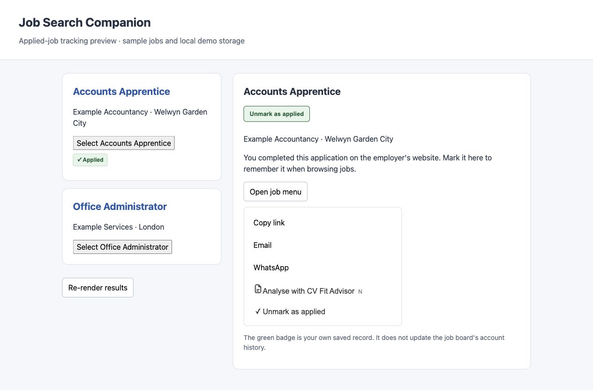

# Job Search Companion

[](https://github.com/MrLawrenceAwe/job-search-companion/actions/workflows/ci.yml)

Chrome extension for tracking applications on Indeed and LinkedIn, browsing job
results, and checking job requirements and CV fit through a local bridge.

**Stack:** JavaScript, Node.js, Chrome Manifest V3, Swift and macOS Accessibility.



*Preview uses sample jobs and separate local demo storage. CV analysis is disabled.*

## Features

- Mark jobs as applied or unsuitable, with persistent badges across open tabs.
- Browse rendered results with **J/K**, hide with **H**, and undo with **U**.
- Check complete loaded Indeed descriptions for blockers using ChatGPT plan usage.
- Challenge individual blockers, receive a direct reply, and integrate accepted factual corrections into your profile for future checks.
- Send a selected job to Codex through **Analyse with CV Fit Advisor** or **N**,
  then reopen its completed analysis from the job card.

Marks are manual local records. After applying on an employer's website, mark its
listing yourself; this does not submit an application or update the job board.
On Indeed, the manual applied option is hidden for jobs identified as Easily
apply or Indeed Apply, in both the detail controls and job menu. It remains
available for applications through another website or email.
See [usage](docs/usage.md) and [blocker checking](docs/blocker-checker.md).

## Install

Requires Node.js 22+. Run `npm ci` and `npm run build`, then load `extension/`
through Chrome's **Load unpacked** control for marks and shortcuts.

Blocker checks additionally need the local bridge and an eligible ChatGPT
connection. CV analysis needs macOS, Xcode Command Line Tools, Codex,
Accessibility permission and a configured `cv-fit-advisor` skill. The skill and
CV files are not included. Follow [setup and removal](docs/setup.md).

After updating, rebuild, reload the unpacked extension and refresh job pages.

## Preview

Serve the repository with `python3 -m http.server 48974 --bind 127.0.0.1`, then
open [the synthetic preview](http://127.0.0.1:48974/test-support/job-marks-preview.html).
It uses production scripts with mock Chrome APIs and needs no account, CV or
bridge. Stop the server with **Ctrl+C**.

## Development

```sh
npm test
```

Requires macOS, Node.js 22+ and Xcode Command Line Tools. Tests build the extension,
type-check the Swift helper and run synthetic Node tests. CI uses Node 22 and 24.
See [design and testing](docs/design.md) and [evaluation reports](docs/evaluations/README.md).

## Privacy and limitations

Marks stay in extension storage. CV tasks use a local service at `127.0.0.1:48973`;
blocker checks send the description and supplied profile/CV evidence through the connected
ChatGPT account. CV handling follows the configured workspace's skill and account.
The bridge stores submission status and rotating logs locally.

Job-board layout changes can break integrations. Synthetic tests do not establish
live job-board or Codex compatibility; see [manual verification](docs/setup.md#3-verify).
This is an independent personal project, unaffiliated with Indeed, LinkedIn or OpenAI.
